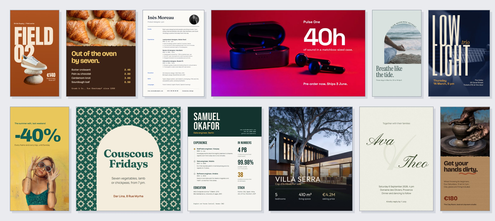
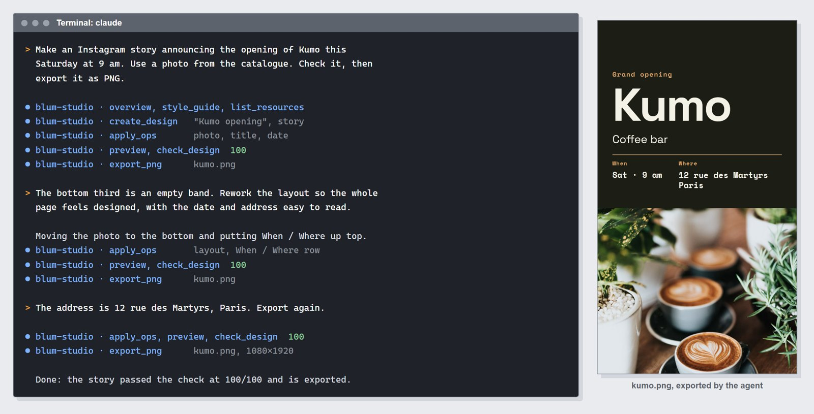
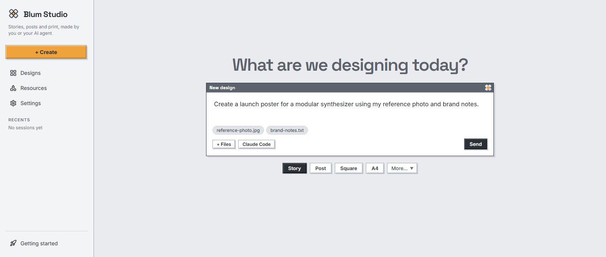
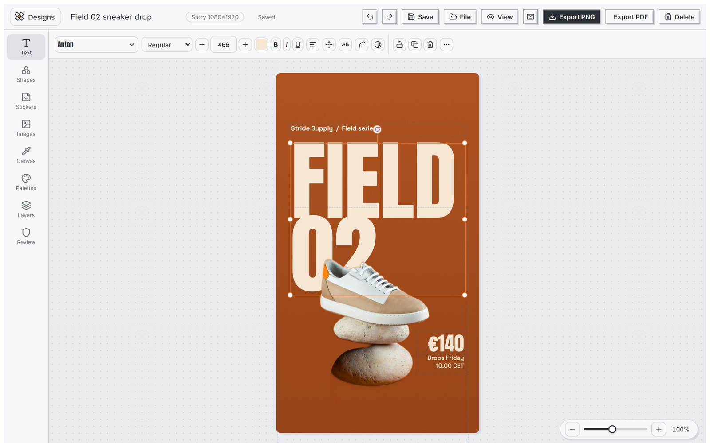
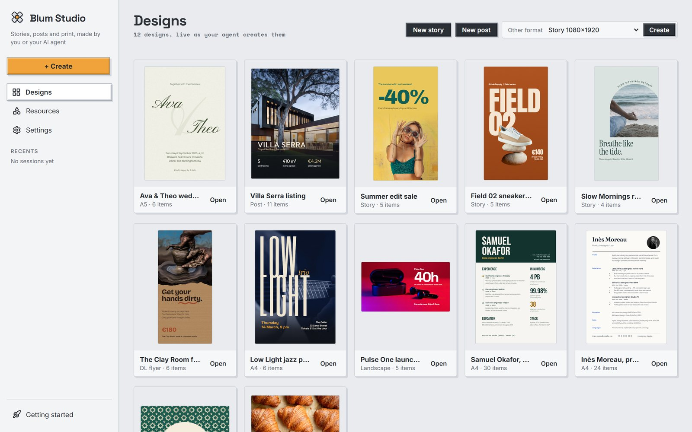
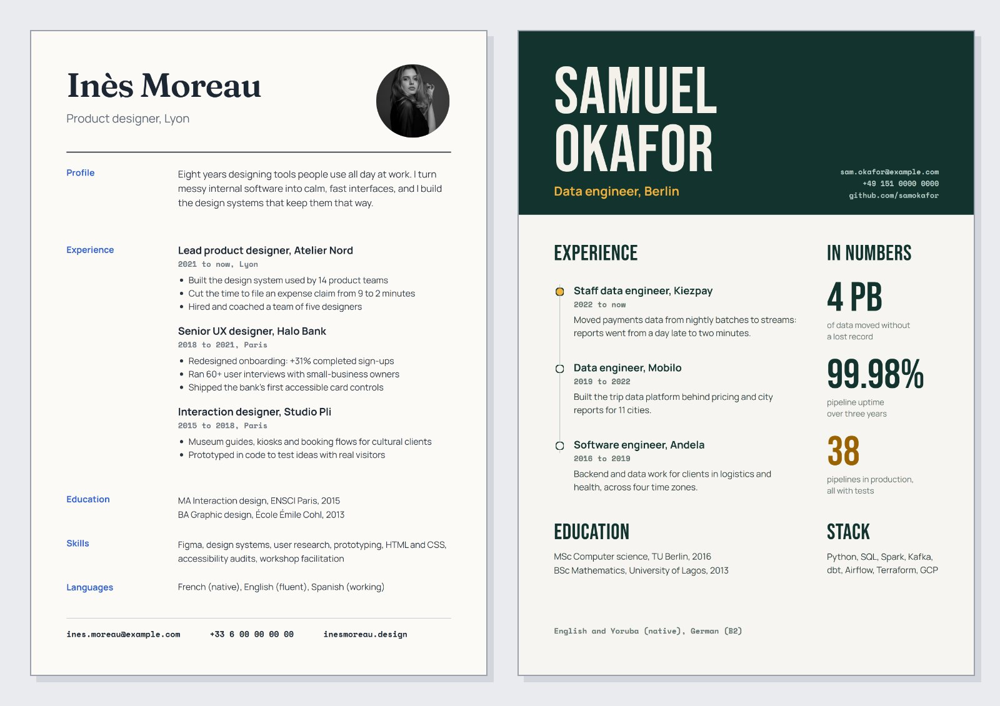

<p align="center">
  
</p>

<h1 align="center">Blum Studio</h1>

<p align="center">
  <b>The MCP server that turns your AI agent into a designer.</b>
</p>

<table align="center">
  <tr>
    <td align="center"><b>01</b></td>
    <td>Ask Claude, Codex, Cursor or any MCP client for a story, a post, a poster, a CV or any other 2D design.</td>
  </tr>
  <tr>
    <td align="center"><b>02</b></td>
    <td>It builds the design, looks at it, checks it and exports it.</td>
  </tr>
  <tr>
    <td align="center"><b>03</b></td>
    <td>The visual editor lets you revisit saved designs and their layers, refine them, or create entirely by hand.</td>
  </tr>
</table>

<p align="center">
  
  
  
  
</p>

<p align="center">
  <a href="#get-started"><b>Get started</b></a> ·
  <a href="#works-with-any-agent">Supported agents</a> ·
  <a href="#built-for-agents">MCP tools</a> ·
  <a href="#roadmap">Roadmap</a> ·
  <a href="ARCHITECTURE.md">Architecture</a>
</p>

<br>

<p align="center">
  
  <br>
  <sub>The twelve examples that ship with Blum Studio. Every one is an editable file you can open, change and export.</sub>
</p>

<br>

<table>
  <tr>
    <td width="25%" valign="top">
      <h3>🤖 An MCP server</h3>
      20 tools for Claude, Codex, Cursor or any MCP client, from the terminal or the desktop app you already use.
    </td>
    <td width="25%" valign="top">
      <h3>🎨 With an editor</h3>
      Open saved designs and their layers, refine the agent's work, or make your own with snapping, photo masks, cut-outs, curved text, patterns and filters.
    </td>
    <td width="25%" valign="top">
      <h3>🔍 It checks its work</h3>
      Contrast, overflow with the real fonts, safe zones, and a care score from 0 to 100.
    </td>
    <td width="25%" valign="top">
      <h3>🖨️ Screen and print</h3>
      Stories, posts, CVs, A3 to A6, US Letter, DL flyers or any size. PNG and vector PDF.
    </td>
  </tr>
</table>

## From your terminal

Blum Studio is not an app you have to learn: it is a set of tools your agent calls. Connect it once, then ask for a design in Claude Code, Codex or any MCP client, right in your terminal. The agent picks a photo, lays out the page, looks at a preview, fixes what it sees and exports the file.

<p align="center">
  
  <br>
  <sub>A real Claude Code session, shortened: three prompts, the tools the agent called, and the PNG it exported (about 2 minutes in all).</sub>
</p>

## How it works

1. **Describe it and add your files.** Ask your agent wherever you already use it: in the terminal with Claude Code or Codex, in Cursor, in Claude Desktop, or on Blum's own Create page. On Create, attach your photos or documents; the agent can place images in the design and read documents for context.
2. **Watch it get built.** The agent creates the design, places the photo, sets the type, then looks at a preview and fixes what it sees.
3. **Take it from there.** Open the same design in the editor, change anything, upload more images if you like, and export a PNG or a print-ready PDF.

<table>
  <tr>
    <td width="50%" valign="top">
      
      <br><sub><b>Create:</b> describe your design, attach your own files, pick a format, and send it to the agent.</sub>
    </td>
    <td width="50%" valign="top">
      
      <br><sub><b>Editor:</b> every agent edit stays a layer you can select and change.</sub>
    </td>
  </tr>
</table>

<p align="center">
  
  <br>
  <sub>The gallery refreshes live while an agent works.</sub>
</p>

## Not just social posts

Text-heavy documents are first-class: columns, bullet lists, justified paragraphs, real fonts measured for overflow, and a vector PDF at the exact page size. Both CVs below are examples you can open and make your own.

<p align="center">
  
  <br>
  <sub>Two A4 CVs, exported as print-ready PDFs with selectable text.</sub>
</p>

## The MCP server and its editor

- **The MCP server** is the heart of Blum Studio: any agent that speaks MCP can create, check, preview and export designs.
- **The editor** runs in your browser, with no account and nothing to upload. Open any saved design to inspect its layers and adjust it, or create a new design entirely by hand. Your designs are JSON files: `designs/` from sources, `~/BlumStudio/designs/` with `npx blum-studio` (`BLUM_DESIGNS` overrides both).

Both work at the same time on the same design. Each design has a write lock, and the editor reloads when an agent changes the file.

## Works with any agent

Blum Studio is a standard MCP server over stdio. It is not tied to one model or one app.

| Agent | How to connect |
|---|---|
| Claude Code | One click in **Settings**, or `npm run connect` |
| Claude Desktop | One click in **Settings**, or `npm run connect` |
| Codex CLI | One click in **Settings** |
| Muse | One click in **Settings** |
| Cursor, Windsurf, Gemini CLI, VS Code and other MCP clients | Add the server to the client's MCP config (below) |

For any other client, add the server to the client's MCP config:

```json
{
  "mcpServers": {
    "blum-studio": {
      "command": "npx",
      "args": ["-y", "blum-studio", "mcp"]
    }
  }
}
```

From sources, point the client at `server/dist/mcp.js` with `BLUM_ROOT` set to the Blum Studio folder instead.

The `preview` tools return images, so the agent can look at its own work. Clients that can't show images still get every other tool.

## Built for agents

The MCP server gives an agent what a designer needs: a way to look at its work, a design check, and rules worth following.

| Tool | What it does |
|---|---|
| `overview`, `style_guide`, `api_info` | Read first: the design rules, and complete examples of every item. |
| `list_formats`, `create_design` | Pick a page size and start a design. |
| `apply_ops`, `undo`, `redo` | Edit in validated batches: add, update, group, align, background. |
| `get_design`, `list_designs`, `delete_draft` | Read and manage designs. |
| `preview`, `preview_board` | Look at the result, or zoom into a region. |
| `check_design`, `polish_score` | Find contrast, overflow and layout problems. |
| `list_resources`, `import_image` | Fonts, stickers, photos; import an image and cut out its subject. |
| `draw_svg` | **SVG workshop**: draw an icon or a custom shape as an editable vector, checked against a strict allowlist, and get a preview back in the same call. |
| `export_png`, `export_pdf` | Export at the page's real size. |

Every argument is validated. A bad call gets back a message that says what to fix, never a crash.

## Get started

Requires **Node.js 20 or newer**. Nothing else: no Python, no compiler, no account.

```sh
npx blum-studio
```

This starts the studio at `http://127.0.0.1:8092/` and opens it in your browser. Your designs live in `~/BlumStudio/designs/`, and Chromium for exports downloads on first launch (one-time, about 170 MB). Set `BLUM_PORT` to use another port, `BLUM_DESIGNS` to move your designs, and `BLUM_NO_OPEN=1` to skip opening the browser.

From sources, for development:

```sh
git clone https://github.com/Loann110/blum_studio && cd blum-studio
npm run setup     # install and build (Chromium downloads on first launch or export)
npm start         # open http://127.0.0.1:8092/
npm run connect   # optional: register the MCP server in Claude Code and Claude Desktop
```

Then connect your agent from the **Settings** page, or see [Works with any agent](#works-with-any-agent).

To work on the code, see [CONTRIBUTING.md](CONTRIBUTING.md) and [ARCHITECTURE.md](ARCHITECTURE.md).

## Status

> [!IMPORTANT]
> Blum Studio is young. The editor, the MCP server and the exports are tested, but expect rough edges.
> - Every MCP agent can design through Blum. The in-app Create page launches Claude Code for now, because it is the only CLI that can be limited to the Blum tools from the command line.
> - It runs on your machine and listens on `127.0.0.1` only. It is not built to be exposed on a network.

**Photos.** The example designs and the photo catalogue use images hosted on [Unsplash](https://unsplash.com), so they need a connection the first time they load.

## Roadmap

**v0.0.1: first public release**
- The visual editor, the MCP server (20 tools), PNG and print-ready PDF export, and twelve example designs.
- **SVG workshop:** a `draw_svg` tool that lets an agent draw exactly what is missing (an icon, a custom shape, a simple logo) and see the result in the same call. SVG is checked against a strict allowlist, and fills use plain hex or rgba colours.
- Published on npm: `npx blum-studio` starts the studio, `npx blum-studio mcp` runs the MCP server. Designs live in `~/BlumStudio/designs/`, and Chromium downloads on first launch or export.

**v0.0.2: Community**
- A community repository where people share SVGs, designs and templates. Every contribution is a pull request checked automatically: safe SVG, a design that loads and passes `check_design`, a declared licence.
- A gallery website generated from that repository, to browse and search.
- In Blum Studio: a **Community** tab to import in one click, a **Share** button that packages a design, and `community_search` / `community_import` tools so agents can reuse what others made.
- Shared content is CC0 or CC BY. Photos must be your own or CC0, fonts come from the Blum catalogue, and the Share button flags personal details before anything leaves your machine.

**Later**
- A hosted community platform with accounts, uploads from the app, collections and moderation, if the shared library takes off.

Ideas and feedback are welcome in the issues.

## License and credits

Blum Studio is licensed under the [GNU Affero General Public License v3.0 or later](LICENSE). If you run a modified version as a network service, you must offer its source to its users.

Fonts (SIL OFL), stickers (Microsoft Fluent Emoji, Tabler Icons, Open Doodles, Kenney), the U²-Net cut-out model and the npm packages keep their own licences. See [THIRD_PARTY_NOTICES.md](THIRD_PARTY_NOTICES.md).

<br>

<p align="center">
  
  <br>
  <sub>Made with Blum Studio, by its authors and contributors.</sub>
</p>
